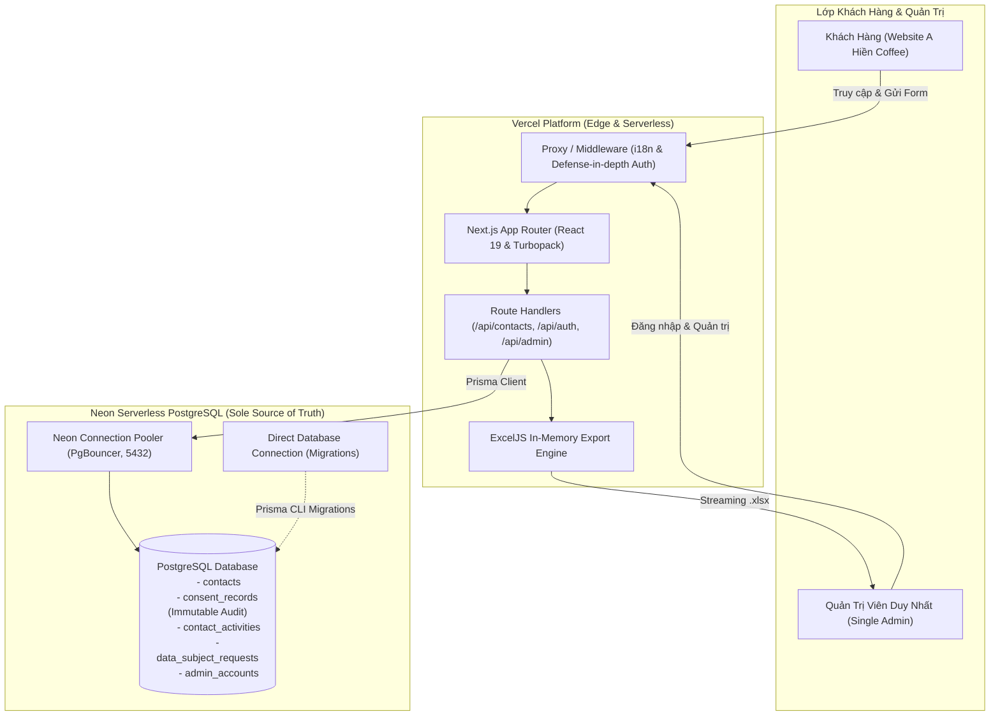
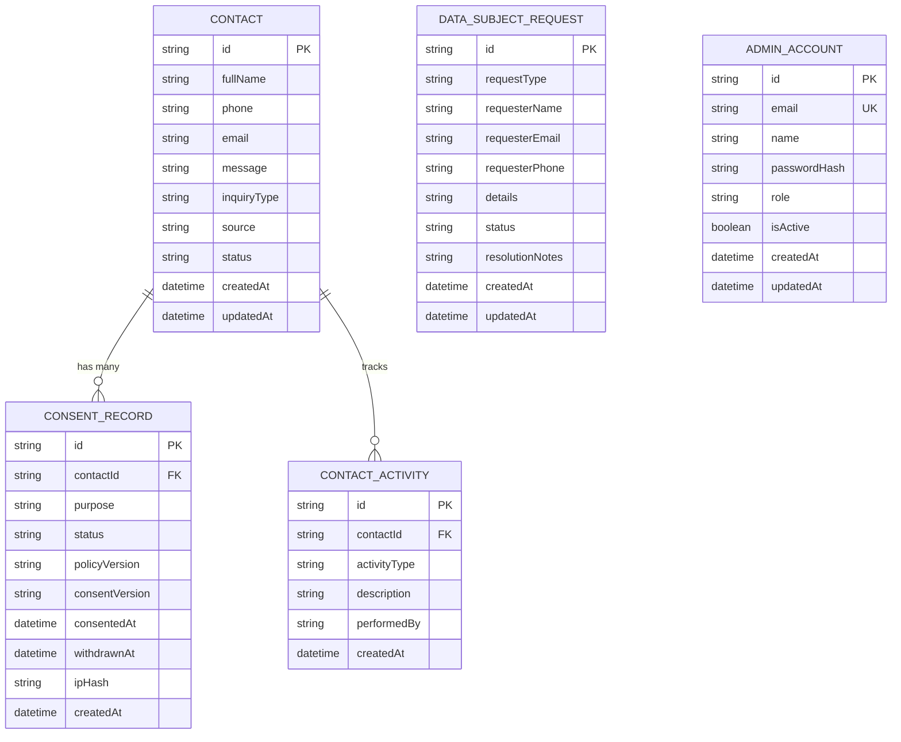

# KIẾN TRÚC HỆ THỐNG A HIỀN COFFEE
## Production Architecture: Vercel + Neon PostgreSQL + Prisma + Single Admin + ExcelJS

---

## 1. TỔNG QUAN KIẾN TRÚC (SYSTEM OVERVIEW)

Hệ thống A Hiền Coffee được xây dựng trên mô hình Serverless hiện đại, tối ưu hóa cho nền tảng Vercel, đảm bảo khả năng mở rộng tức thì, chi phí vận hành tối thiểu và tuân thủ cao nhất về bảo vệ dữ liệu cá nhân.

---

## 2. NGUYÊN TẮC THIẾT KẾ CỐT LÕI (CORE PRINCIPLES)

1. **Vercel Runs the Application:** Ứng dụng chạy hoàn toàn dưới dạng serverless functions trên hạ tầng Vercel toàn cầu.
2. **Neon PostgreSQL Persists the Data:** Neon PostgreSQL là **nguồn chân lý duy nhất (Sole Source of Truth)**. Tuyệt đối không sử dụng lưu trữ tạm bợ hay file hệ thống cục bộ trên serverless container.
3. **Prisma Manages the Database:** Quản lý schema, migrations và truy vấn kiểu tĩnh (type-safe) thông qua Prisma ORM v6.
4. **Single Admin Security:** Chính xác một tài khoản Quản trị viên được ủy quyền quản lý thông tin liên hệ và phản hồi khách hàng.
5. **ExcelJS Generates Reports On-Demand:** Báo cáo Excel đa sheet được kết xuất hoàn toàn trong bộ nhớ (in-memory) và gửi dạng stream về trình duyệt khi Admin yêu cầu, phòng chống triệt để tấn công chèn mã độc vào bảng tính (Formula Injection).
6. **Privacy by Design:** Thu thập dữ liệu theo nguyên tắc tối thiểu hóa (Data Minimization), tách biệt hoàn toàn sự đồng ý vận hành và tiếp thị, lưu vết bằng chứng đồng ý bất biến theo Luật 91/2025/QH15.

---

## 3. SƠ ĐỒ THỰC THỂ QUAN HỆ (DATABASE ERD)

