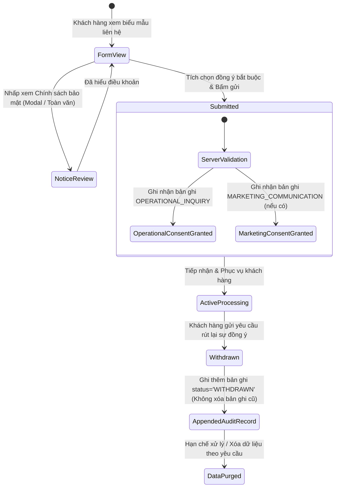

# QUẢN LÝ SỰ ĐỒNG Ý & VÒNG ĐỜI DỮ LIỆU CÁ NHÂN
## Tuân thủ Luật số 91/2025/QH15 & Nghị định số 356/2025/NĐ-CP

---

## 1. NGUYÊN TẮC THU THẬP SỰ ĐỒNG Ý (CONSENT PRINCIPLES)

1. **Tự nguyện, Rõ ràng & Có thể Kiểm chứng:** Khách hàng được thông báo trước về mục đích xử lý dữ liệu và chủ động đưa ra quyết định.
2. **Không Tích Sẵn (No Pre-selected Checkboxes):** Các ô chọn đồng ý mặc định ở trạng thái chưa tích (`checked={false}`).
3. **Cấm Suy Diễn Sự Im Lặng:** Sự im lặng hoặc không phản hồi tuyệt đối không được coi là sự đồng ý.
4. **Tách Biệt Độc Lập Các Mục Đích (Purpose Independence):**
   - **Mục đích Vận hành (`OPERATIONAL_INQUIRY`):** Bắt buộc để liên hệ phản hồi hoặc xác nhận đặt bàn.
   - **Mục đích Tiếp thị (`MARKETING_COMMUNICATION`):** Hoàn toàn tùy chọn, khách hàng không tích ô này vẫn gửi liên hệ thành công.
5. **Thẩm Quyền Thuộc Về Máy Chủ (Server-Authoritative):**
   - Phiên bản chính sách (`policyVersion: "v1.0.0-2026.01"`) và thời điểm đồng ý (`consentedAt: new Date()`) do máy chủ đóng dấu, không tin tưởng client input.

---

## 2. VÒNG ĐỜI SỰ ĐỒNG Ý (CONSENT LIFECYCLE)

---

## 3. CẤU TRÚC LƯU VẾT KIỂM TOÁN (CONSENT AUDIT TRAIL)

Mỗi sự đồng ý được lưu trữ độc lập trong bảng `consent_records`:
- `id`: Mã UUID định danh bản ghi.
- `contactId`: Khóa ngoại liên kết với thông tin khách hàng.
- `purpose`: `"OPERATIONAL_INQUIRY"` hoặc `"MARKETING_COMMUNICATION"`.
- `status`: `"GRANTED"` (Đã cấp) hoặc `"WITHDRAWN"` (Đã rút lại).
- `policyVersion`: Phiên bản chính sách tại thời điểm đồng ý (ví dụ: `v1.0.0-2026.01`).
- `consentVersion`: Mã phiên bản câu từ đồng ý (`consent_v1`).
- `consentedAt`: Dấu thời gian máy chủ tại thời điểm đồng ý.
- `withdrawnAt`: Dấu thời gian máy chủ tại thời điểm rút lại (nếu có).
- `ipHash`: Mã băm SHA-256 một chiều từ địa chỉ IP của khách hàng kèm salt bảo mật (`IP_SALT`), giúp kiểm chứng nguồn gốc mà không lưu địa chỉ IP thô.

---

## 4. XỬ LÝ YÊU CẦU QUYỀN CHỦ THỂ DỮ LIỆU (DATA SUBJECT RIGHTS - DSR)

Hệ thống tiếp nhận yêu cầu DSR qua endpoint `POST /api/privacy/dsr` và lưu vào bảng `data_subject_requests`:
- `requestType`:
  - `ACCESS`: Yêu cầu xem lại dữ liệu cá nhân đã lưu trữ.
  - `CORRECTION`: Yêu cầu đính chính thông tin bị sai sót.
  - `DELETION`: Yêu cầu xóa dữ liệu cá nhân.
  - `RESTRICTION`: Yêu cầu hạn chế phạm vi xử lý dữ liệu.
  - `WITHDRAWAL`: Yêu cầu rút lại sự đồng ý nhận thông tin tiếp thị.
- Thời hạn phản hồi theo quy định: Tối đa **72 giờ làm việc**.

