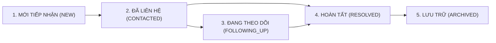

# QUY TRÌNH QUẢN LÝ LIÊN HỆ & CHĂM SÓC KHÁCH HÀNG
## Hướng Dẫn Vận Hành Cho Quản Trị Viên A Hiền Coffee

---

## 1. VÒNG ĐỜI TRẠNG THÁI LIÊN HỆ (CONTACT LIFECYCLE)

Mỗi liên hệ gửi từ website trải qua các trạng thái xử lý sau:

| Mã Trạng Thái | Tên Tiếng Việt | Mô Tả Ý Nghĩa & Hành Động Tiếp Theo |
|---|---|---|
| `NEW` | Mới tiếp nhận | Khách hàng vừa gửi thông tin qua form. Quản trị viên cần liên hệ trong vòng 15-30 phút để xác nhận. |
| `CONTACTED` | Đã liên hệ | Nhân viên đã gọi điện thoại hoặc gửi email phản hồi lần đầu cho khách hàng. |
| `FOLLOWING_UP` | Đang theo dõi | Cần trao đổi thêm (ví dụ: đang chuẩn bị sắp xếp bàn tiệc, đổi khung giờ, tư vấn combo cà phê). |
| `RESOLVED` | Hoàn tất | Yêu cầu đã được giải quyết trọn vẹn (khách hàng đã nhận bàn hoặc nhận được câu trả lời hài lòng). |
| `ARCHIVED` | Lưu trữ | Thông tin lịch sử đã qua chu kỳ phục vụ, lưu trữ phục vụ báo cáo nội bộ. |

---

## 2. PHÂN LOẠI YÊU CẦU (INQUIRY TYPES)

- `TABLE_RESERVATION`: Đặt bàn trước, yêu cầu chỗ ngồi hoặc không gian yên tĩnh.
- `GENERAL_INQUIRY`: Hỏi đáp thông tin về quán, giờ mở cửa, chỉ đường.
- `COFFEE_PRODUCT`: Khách hàng hỏi mua các dòng hạt cà phê rang mộc Specialty (Arabica Cầu Đất, Robusta Buôn Ma Thuột).
- `EVENT_WORKSHOP`: Liên hệ tổ chức sự kiện gia đình, họp nhóm hoặc workshop cà phê thủ công.

---

## 3. THAO TÁC TRÊN BẢNG ĐIỀU KHIỂN (ADMIN DASHBOARD)

1. **Truy cập bảng điều khiển:** Đăng nhập tại `/login`, hệ thống tự động chuyển hướng đến `/admin/contacts`.
2. **Tìm kiếm & Lọc dữ liệu:**
   - Ô tìm kiếm hỗ trợ tra cứu tức thì theo Họ tên, Số điện thoại hoặc Email.
   - Lọc theo từng Trạng thái hoặc Loại yêu cầu.
   - Lọc theo khoảng ngày (Từ ngày - Đến ngày).
3. **Cập nhật trạng thái & Ghi chú chăm sóc:**
   - Nhấp nút **"Chi tiết"** ở hàng dữ liệu khách hàng.
   - Chọn trạng thái mới và nhập ghi chú ngắn gọn (ví dụ: *"Đã gọi xác nhận giữ bàn số 3 lúc 19h30"*).
   - Bấm **"Cập nhật"**. Hành động này được ghi nhận ngay vào Lịch sử chăm sóc (Activity Log).
4. **Xuất Sổ Cái Excel:**
   - Bấm nút **"Xuất Báo Cáo Excel (.xlsx)"** ở góc trên bên phải.
   - File Excel chứa toàn bộ danh sách liên hệ (theo bộ lọc hiện hành), bằng chứng đồng ý và lịch sử chăm sóc sẽ được tải trực tiếp về máy tính.

